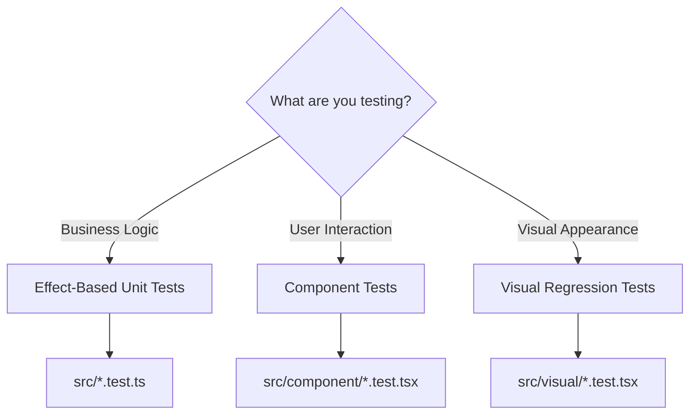
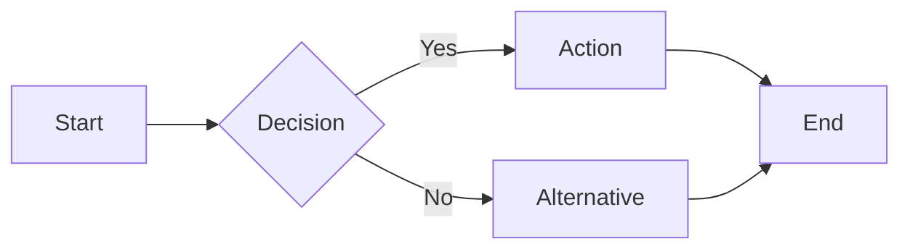

# Contributing Guide

Welcome to the Effect TanStack Start project! This guide will help you understand the project structure, development workflow, and how to contribute effectively.

## Table of Contents

- [Getting Started](#getting-started)
- [Project Architecture](#project-architecture)
- [Development Workflow](#development-workflow)
- [Testing](#testing)
- [Observability](#observability)
- [Code Style](#code-style)
- [Pull Request Process](#pull-request-process)
- [Documentation](#documentation)

---

## Getting Started

### Quick Setup

```bash
# Clone and install
git clone <repository-url>
cd effect-tanstack-start
bun install

# Install test dependencies
bunx playwright install --with-deps

# Copy environment template
cp .env.example .env

# Start development
bun run dev
```

📚 **Detailed Guide:** [Getting Started](./docs/guides/getting-started.md)

### Docker Setup (Recommended for Full Stack)

```bash
# Generate secrets
openssl rand -hex 32  # For SENTRY_SECRET_KEY
openssl rand -hex 32  # For POSTHOG_SECRET_KEY

# Configure
cp .env.docker .env
# Edit .env with generated secrets

# Start everything
docker-compose up
```

📚 **Detailed Guide:** [Docker Setup](./DOCKER_SETUP.md)

---

## Project Architecture

### High-Level Overview

```mermaid
graph TB
    subgraph "Frontend"
        UI[React 19 + TanStack Router]
        State[@effect-atom]
    end

    subgraph "Backend"
        Server[Nitro + Bun]
        Effect[Effect-TS Runtime]
    end

    subgraph "Observability"
        Monitoring[Grafana Stack]
        Errors[Sentry]
        Analytics[PostHog]
    end

    UI <--> Server
    UI --> State
    Server --> Effect

    UI --> Analytics
    UI --> Errors
    Server --> Monitoring
    Server --> Analytics
    Server --> Errors
```

### Technology Stack

| Layer               | Technologies                                            |
| ------------------- | ------------------------------------------------------- |
| **Frontend**        | React 19, TanStack Router, @effect-atom, Tailwind CSS 4 |
| **Backend**         | Bun, Nitro, Effect-TS, @effect/rpc                      |
| **Testing**         | Vitest 4, @effect/vitest, Playwright                    |
| **Monitoring**      | Grafana, Loki, Tempo, Prometheus                        |
| **Error Tracking**  | Sentry (self-hosted)                                    |
| **Analytics**       | PostHog (self-hosted)                                   |
| **Runtime**         | Bun                                                     |
| **Package Manager** | Bun                                                     |

📚 **Detailed Guide:** [Architecture Overview](./docs/architecture/overview.md)

---

## Development Workflow

### 1. Create a Feature Branch

```bash
git checkout -b feature/your-feature-name
```

### 2. Make Changes

Edit code with hot reload:

```bash
bun run dev
# App runs on http://localhost:3000
# Changes auto-reload
```

### 3. Write Tests

```bash
# Unit tests (Effect-based)
touch src/features/my-feature.test.ts

# Component tests
touch src/component/MyComponent.test.tsx

# Visual regression tests
touch src/visual/MyComponent.visual.test.tsx
```

📚 **Testing Guide:** [Complete Testing Documentation](./docs/guides/testing.md)

### 4. Run Tests Locally

```bash
# Run all tests
bun run test

# Run specific test suites
bun run test:unit        # Effect-based tests
bun run test:component   # Component tests
bun run test:visual      # Visual regression

# Watch mode
bun run test:watch
```

### 5. Type Check

```bash
bun run typecheck
```

### 6. Commit Changes

```bash
git add .
git commit -m "feat: add new feature"
```

**Commit Message Format:**

```
type(scope): subject

body

footer
```

**Types:** `feat`, `fix`, `docs`, `style`, `refactor`, `test`, `chore`

**Examples:**

```
feat(auth): add login with PostHog tracking
fix(ui): correct button alignment on mobile
docs(readme): update setup instructions
test(api): add tests for user endpoints
```

---

## Testing

### Test Types and When to Use Them



### Writing Tests

#### Effect-Based Unit Test

```typescript
import { expect, it } from "@effect/vitest"
import { Effect } from "effect"

it.effect("calculates total correctly", () =>
  Effect.gen(function*() {
    const result = yield* calculateTotal([10, 20, 30])
    expect(result).toBe(60)
  }))
```

#### Component Test

```typescript
import { expect, test } from "vitest"
import { render } from "vitest-browser-react"
import { page } from "vitest/browser"

test("button click updates counter", async () => {
  render(<Counter />)

  const button = page.getByRole("button", { name: /increment/i })
  await button.click()

  await expect.element(page.getByText("Count: 1")).toBeVisible()
})
```

#### Visual Regression Test

```typescript
import { expect, test } from "vitest"
import { render } from "vitest-browser-react"

test("card component visual", async () => {
  const screen = render(<Card title="Test" />)
  await expect(screen.container).toMatchScreenshot("card-default")
})
```

📚 **Complete Guide:** [Testing Documentation](./docs/guides/testing.md)

---

## Observability

### Adding Telemetry to Your Code

#### Server-Side Tracing

```typescript
import { Effect } from "effect"

const myOperation = Effect
  .gen(function*() {
    yield* Effect.log("Starting operation")

    // Your code here

    yield* Effect.log("Operation completed")
  })
  .pipe(
    Effect.withSpan("myOperation", {
      attributes: { userId: "123" },
    }),
  )
```

#### Client-Side Analytics

```typescript
import { trackEvent } from "./lib/posthog-client"

function handleButtonClick() {
  trackEvent("button_clicked", {
    button_id: "signup",
    page: window.location.pathname,
  })

  // Your code here
}
```

#### Error Tracking

```typescript
import { captureException } from "./lib/telemetry-client"

try {
  // Your code here
} catch (error) {
  captureException(error)
  throw error
}
```

### Viewing Observability Data

| Service     | URL                   | Purpose                     |
| ----------- | --------------------- | --------------------------- |
| **Grafana** | http://localhost:3001 | Logs, traces, metrics       |
| **Sentry**  | http://localhost:9000 | Errors and performance      |
| **PostHog** | http://localhost:8001 | Analytics and feature flags |

📚 **Complete Guides:**

- [Telemetry Documentation](./docs/guides/telemetry.md)
- [PostHog Documentation](./docs/guides/posthog.md)

---

## Code Style

### TypeScript

- **Use strict mode** - Enable all strict TypeScript options
- **Prefer Effect** - Use Effect-TS for business logic
- **Type everything** - No `any` types
- **Use const** - Prefer `const` over `let`

### React

- **Functional components** - No class components
- **Hooks** - Use React hooks appropriately
- **Props** - Define prop types with TypeScript interfaces
- **Effects** - Use @effect-atom for state management

### Effect-TS

```typescript
// ✅ Good - Use Effect.gen
const program = Effect.gen(function*() {
  const user = yield* fetchUser(id)
  const posts = yield* fetchPosts(user.id)
  return { user, posts }
})

// ❌ Avoid - Nested pipes
const program = fetchUser(id).pipe(
  Effect.flatMap(user =>
    fetchPosts(user.id).pipe(
      Effect.map(posts => ({ user, posts })),
    )
  ),
)
```

### Naming Conventions

- **Files** - `kebab-case.ts`, `PascalCase.tsx` for components
- **Variables** - `camelCase`
- **Constants** - `UPPER_SNAKE_CASE`
- **Types/Interfaces** - `PascalCase`
- **Functions** - `camelCase`, descriptive names

---

## Pull Request Process

### 1. Ensure Tests Pass

```bash
bun run test
bun run typecheck
```

### 2. Update Documentation

- Update relevant documentation in `docs/`
- Add JSDoc comments for public APIs
- Update README if needed

### 3. Create Pull Request

**PR Title Format:**

```
type(scope): brief description
```

**PR Description Template:**

```markdown
## Description

Brief description of changes

## Type of Change

- [ ] Bug fix
- [ ] New feature
- [ ] Breaking change
- [ ] Documentation update

## Testing

- [ ] Unit tests added/updated
- [ ] Component tests added/updated
- [ ] Visual tests added/updated
- [ ] All tests passing

## Checklist

- [ ] Code follows style guidelines
- [ ] Self-review completed
- [ ] Documentation updated
- [ ] No new warnings
```

### 4. Review Process

- Automated checks must pass
- At least one approval required
- Address review feedback
- Maintain clean commit history

### 5. Merge

- Use "Squash and Merge" for feature branches
- Delete branch after merge

---

## Documentation

### Where to Add Documentation

```
docs/
├── architecture/        # System architecture and diagrams
│   └── overview.md
├── guides/              # How-to guides
│   ├── getting-started.md
│   ├── testing.md
│   ├── telemetry.md
│   ├── posthog.md
│   └── docker.md
└── diagrams/            # Standalone diagrams (future)
```

### Documentation Standards

1. **Use Mermaid** - For diagrams and flowcharts
2. **Code Examples** - Include working code snippets
3. **Screenshots** - Add screenshots for UI features
4. **Links** - Cross-reference related documentation
5. **Keep Updated** - Update docs with code changes

### Adding Diagrams

Use Mermaid.js syntax:



---

## Project Structure

```
effect-tanstack-start/
├── docs/                          # Documentation
│   ├── architecture/              # Architecture docs
│   └── guides/                    # How-to guides
├── docker/                        # Docker configs
├── src/
│   ├── api/                       # API layer
│   ├── lib/                       # Shared libraries
│   ├── routes/                    # Pages and API routes
│   ├── component/                 # Component tests
│   ├── visual/                    # Visual regression tests
│   └── *.test.ts                  # Unit tests
├── Dockerfile                     # Container build
├── docker-compose.yml             # Service orchestration
├── CONTRIBUTING.md                # This file
├── DOCKER_SETUP.md                # Docker guide
└── TESTING_AND_TELEMETRY.md       # Testing & observability
```

---

## Need Help?

### Documentation Resources

- 📚 [Getting Started Guide](./docs/guides/getting-started.md)
- 🏗️ [Architecture Overview](./docs/architecture/overview.md)
- 🧪 [Testing Guide](./docs/guides/testing.md)
- 📊 [Telemetry Guide](./docs/guides/telemetry.md)
- 📈 [PostHog Guide](./docs/guides/posthog.md)
- 🐳 [Docker Guide](./docs/guides/docker.md)
- 🗄️ [Database Guide - PostgreSQL](./docs/guides/database-postgresql.md)
- 💾 [Database Guide - SQLite](./docs/guides/database-sqlite.md)
- ✨ [Code Quality Guide](./docs/guides/code-quality.md)
- 🤖 [AI Code Review Guide](./docs/guides/ai-code-review.md)
- ⚡ [Performance Monitoring](./docs/guides/performance-monitoring.md)

### External Resources

- [Effect Documentation](https://effect.website)
- [TanStack Router](https://tanstack.com/router/latest)
- [Vitest](https://vitest.dev)
- [Bun](https://bun.sh)

### Community

- Open an issue for bugs
- Start a discussion for questions
- Submit PRs for improvements

---

## License

[Your License Here]

---

Thank you for contributing! 🎉
