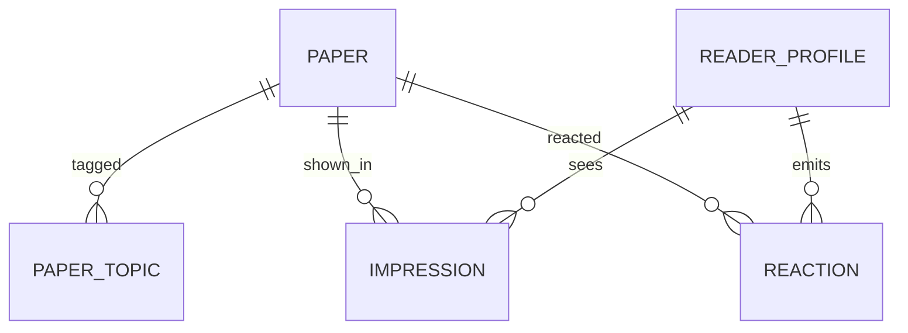
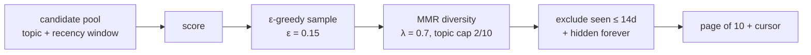

# AcademiTok — Build Specification

> Status: P0 candidate · Owner: feed · Supersedes: implicit prototype intent in `src/routes/-index/`

## 1. Product

A short-form, full-screen, swipe-native feed of **academic papers**, dressed as an **old-school
newspaper broadsheet**. The reader meets one paper per screen, reacts in under a second, and the
feed adapts: topic weight, author/venue affinity, and content similarity move with every
impression, dwell, like, save, hide and open.

Positioning sentence: _"TikTok's rhythm, a newsroom's typography, a researcher's firehose."_

Success = a reader saves 1–3 papers per 100 impressions without filtering manually, and the
composition of the feed visibly shifts toward what they actually read.

## 2. Non-goals (explicitly cut)

- No social graph, comments, follower counts, or profiles in P0–P2.
- No PDF hosting, full-text extraction, or highlight rewriting. Metadata + link out only.
- No LLM summarisation in P0 (abstract-derived dek only). Revisit in P2 behind a flag.
- No native mobile app. Responsive web, mobile-first; gestures degrade to buttons.
- No collaborative filtering across users until there are users.
- No recommendation "training jobs". Learning is online and per-reader.

## 3. Current state — keep or restart

The repo is an Effect/TanStack template with a working paper-feed prototype on branch
`feat/paper-feed-newspaper`. Audit result:

| Area                                                          | Files                                                                      | Verdict                             | Reasoning                                                                                                                                                                |
| ------------------------------------------------------------- | -------------------------------------------------------------------------- | ----------------------------------- | ------------------------------------------------------------------------------------------------------------------------------------------------------------------------ |
| Runtime stack (Effect, TanStack Start, Drizzle/PGlite, atoms) | whole `src/`, `vite.config.ts`                                             | **KEEP**                            | Validated, instrumented, matches repo patterns. No reason to fight it.                                                                                                   |
| Contracts                                                     | `src/api/paper-schema.ts`                                                  | **KEEP + EXTEND**                   | Effect Schema is the right boundary. Add `Impression`, `FeedPage`, `Cursor`, `OnboardingPicks`.                                                                          |
| Reaction reducer                                              | `src/features/papers/reactions.ts`                                         | **KEEP**                            | Correct event-sink shape: append, toggle, dedupe.                                                                                                                        |
| Scoring core                                                  | `src/features/papers/recommendation.ts` (`topicWeights`, decay, rationale) | **KEEP AS BASELINE**                | The decayed topic-affinity idea is sound. It becomes one term in a larger scorer.                                                                                        |
| Single-shot sort as the feed                                  | `buildFeedItems()` returning one fully sorted catalog                      | **REPLACE**                         | Root cause of the fake feed. A global sort of everything is not a feed: it repeats, has no exploration, no diversity, no paging.                                         |
| Infinite deck by duplication                                  | `cycleIndex` re-mapping in `src/routes/-index/app.tsx`                     | **DELETE**                          | Cycles the same N papers. This is the prototype's biggest lie.                                                                                                           |
| Catalog resolution per request                                | `resolveCatalog()` in `application.ts` calling OpenAlex on every snapshot  | **REPLACE**                         | No cache, no upstream budget, no dedupe, no persistence. Becomes `PaperCatalog` service with DB pool + TTL refresh.                                                      |
| Reader persistence                                            | `src/db/reader-state-repository.ts`, `reader_state` table                  | **KEEP, SPLIT LATER**               | Single JSON blob is fine for one reader. Split into `reactions`/`impressions` tables when multi-reader or aggregation lands (threshold: >5k reaction rows or >1 reader). |
| Feed UI shell                                                 | `FeedDeck`, `FeedStateSlide`, `PaperSlide`, `EdgeDrawer`                   | **REBUILD LAYOUT, KEEP PRIMITIVES** | Drawer and state slides are reusable. The deck's duplicate-cycle and the panel `78vh` viewport are wrong.                                                                |
| Newspaper styling                                             | warm oklch paper tokens + Georgia body in `src/styles.css`                 | **KEEP + EXTEND**                   | Good foundation, too timid. Needs display scale, rules, stamps, folios, halftone texture.                                                                                |
| Todo feature + todo docs                                      | `src/features/todos/`, `docs/app/todo-*`                                   | **RETIRED**                         | Template residue, removed in one cleanup commit once the feed was green.                                                                                                 |
| Repo identity                                                 | `README.md`, `package.json` name `effect-tanstack-start`                   | **REPLACE**                         | Product docs must describe AcademiTok.                                                                                                                                   |

**Verdict: refactor, not rewrite.** The plumbing is correct and expensive to redo; the feed model
is what is wrong, and it is ~3 files.

## 4. Surfaces

```
┌──────────────────────────────────────────────┐
│  /                     full-screen feed deck │  P0
│  /desk                 profile, beats, stats │  P0 (drawer, not route)
│  /saved                saved clippings       │  P2 (route)
│  /paper/$id            permalink + cite      │  P2 (route)
└──────────────────────────────────────────────┘
```

The desk stays an **edge drawer** (swipe in from the left, `Esc` closes) so the feed never loses
its full-screen contract.

## 5. Interaction spec

### 5.1 Deck contract

- Deck is `100dvh`, `overflow-y: auto`, `scroll-snap-type: y mandatory`, one child per paper with
  `scroll-snap-align: start`.
- Exactly one clipping at rest. Nothing else on screen except the rail, folio and masthead strip.
- Only the visible slide ±1 is mounted with full content; neighbours render a skeleton (windowing).
- No paginated scrolling inside a slide. If the abstract is long, it is truncated with `…` and the
  full text lives at the source link or the P2 permalink.

### 5.2 Navigation and actions

| Input                                               | Action            | Notes                                                          |
| --------------------------------------------------- | ----------------- | -------------------------------------------------------------- |
| Swipe up / wheel down / `ArrowDown` / `j` / `Space` | next clipping     | `Space` respects focused element                               |
| Swipe down / wheel up / `ArrowUp` / `k`             | previous clipping | Re-emitting `previous` never re-arms the impression            |
| Double-tap / `l` / rail heart                       | like              | vermilion stamp animation, removable                           |
| `s` / rail bookmark                                 | save              | toast "filed in clippings"                                     |
| `h` / rail cross                                    | hide              | removes from feed, topic affinity penalty, undo via toast (5s) |
| `o` / rail arrow / `Enter` on link                  | open source       | new tab, `rel="noopener noreferrer"`, tracked                  |
| `d` / rail dots                                     | open desk drawer  | focus trap, `Esc` closes                                       |
| `?`                                                 | shortcut sheet    | P2                                                             |

Rail sits in the right margin, outside the text measure, as a vertical column of icon + micro-label.

### 5.3 Slide anatomy (the clipping)

```
┌─────────────────────────────────────────────────┐
│ ACADEMITOK              EVENING EDITION  No. 042│ masthead strip, hairline under
├─────────────────────────────────────────────────┤
│ ARTIFICIAL INTELLIGENCE                         │ kicker: caps, 0.18em tracking
│                                                 │
│  Scaling Sparse Mixture-of-Experts   ▐          │ display serif, 2 lines max
│  Routing Without Token Collapse      ▐          │
│                                                 │
│  A routing prior cuts expert load imbalance by   │ dek = first 2 abstract
│  forty percent on three benchmarks while …       │ sentences, 60ch measure
│                                                 │
│  R. Aydin, M. Okonkwo, L. Feng · Preprint, 2025  │ byline + dateline
│  arXiv · 412 citations · 6 min          [OPEN]   │ footer facts + access badge
│                                                 │
│  ┌ WHY THIS ────────────┐                       │ "editor's note" stamp,
│  │ Matches AI, Robotics │                       │ replaces opaque AI magic
│  │ Held your attention  │                       │
│  └──────────────────────┘                       │
└─────────────────────────────────────────────────┘
```

Rules: headline ≤ 2 lines at 100dvh × 390px; dek ≤ 240 characters; stamps use the single accent
ink; every fact comes from real metadata, never invented.

### 5.4 Newspaper identity (design tokens)

Extend `src/styles.css` `@theme`; never hardcode colour in components.

| Token                | Value                                                  | Use                            |
| -------------------- | ------------------------------------------------------ | ------------------------------ |
| `--color-ink`        | `oklch(0.18 0.012 60)`                                 | headline + body                |
| `--color-ink-muted`  | `oklch(0.44 0.014 60)`                                 | byline, folio                  |
| `--color-paper`      | `oklch(0.972 0.014 92)`                                | clipping ground                |
| `--color-paper-deep` | `oklch(0.945 0.018 88)`                                | outer gutter                   |
| `--color-rule`       | `oklch(0.82 0.012 80)`                                 | hairlines                      |
| `--color-stamp`      | `oklch(0.52 0.19 28)`                                  | stamps, like state, hide state |
| `--font-display`     | `Georgia, "Iowan Old Style", "Times New Roman", serif` | headlines                      |
| `--font-body`        | same stack, `font-variant-numeric: oldstyle-nums`      | body, bylines                  |
| `--font-label`       | `ui-monospace, "SFMono-Regular", monospace`            | kickers, folio, rail labels    |

Texture: paper grain via layered `repeating-linear-gradient` at ≤3% opacity — no image assets.
Dark mode is a **night edition**: deep ink ground, bone text, same accent.
Type scale (rem): folio 0.68, kicker 0.75, dek 1.0–1.125, byline 0.85, headline clamp(2.0 → 3.4).
Measure: 58–62ch. Leading: 1.45 body, 1.02 headline. Never centre body copy.

### 5.5 Motion

Scroll-snap does the heavy lifting. Only three animations exist: snap settle (240ms
`cubic-bezier(.2,.8,.2,1)`), stamp press (scale .92 → 1, 180ms), toast slide (200ms). All wrapped in
`@media (prefers-reduced-motion: reduce)` → no transform, no transition.

## 6. Data model



Drizzle (`src/db/schema.ts`):

| Table             | Key columns                                                                                                                                                                                                                                | Note                                                        |
| ----------------- | ------------------------------------------------------------------------------------------------------------------------------------------------------------------------------------------------------------------------------------------ | ----------------------------------------------------------- |
| `papers`          | `id` (DOI or source id, PK), `title`, `abstract`, `summary`, `year`, `venue`, `authors jsonb`, `topics jsonb`, `citations`, `read_minutes`, `site`, `source`, `external_url`, `is_open_access`, `allowed_institutions jsonb`, `fetched_at` | Local pool; feed writes it, `/saved` and permalinks read it |
| `impressions`     | `id`, `reader_id`, `paper_id`, `shown_at`, `dwell_ms`, `position`                                                                                                                                                                          | One row per slide that entered viewport ≥ 400ms             |
| `reactions`       | `id`, `reader_id`, `paper_id`, `kind`, `active`, `created_at`                                                                                                                                                                              | Append-only; `active=false` = undo                          |
| `reader_profiles` | `id`, `name`, `institution`, `beats jsonb`, `onboarded_at`                                                                                                                                                                                 | Replaces profile-inside-blob                                |
| `feed_sessions`   | `id`, `reader_id`, `cursor`, `started_at`                                                                                                                                                                                                  | Cursor state for paging                                     |

Keep the existing JSON `reader_state` blob **only** as a migration source; P0 may continue writing
it behind `ReaderStateRepository` until the tables land, but the feed API must speak in
`FeedPage`, not "the whole sorted catalog".

Retention: impressions 90 days, reactions forever, papers refreshed every 24h or when a topic's
pool drops below `limit × 3`.

## 7. Ingestion (`PaperCatalog` Effect service)

- Sources: **OpenAlex** (primary, metadata + inverted abstract), **arXiv** (P2, atom feed),
  **bioRxiv/medRxiv** (P2), **Crossref** (P2, DOI enrichment).
- Flow: `TopicRefresh` → fetch 200 works per beat, normalise → `Paper` → upsert by DOI, dedupe by
  normalised title (Jaccard > 0.9) → log counts.
- Polite usage: `mailto` in the OpenAlex query, one concurrent request per host, exponential backoff
  (1s → 8s, 3 tries), hard 10s timeout, circuit-break a source for 15 min after 3 consecutive errors.
- Cache is the DB. If the pool is empty **and** upstream fails, serve a frozen seed file
  (`src/data/papers.ts`) with a visible "offline edition" notice. Never an empty screen.
- Abstract reconstruction from `abstract_inverted_index` is `O(n log n)` per work; keep the existing
  helper, add a property test (reconstruct → no duplicated words, order preserved).

## 8. Recommendation system ("the algo")

Bandit-lite, deterministic, explainable, no training infrastructure.

### 8.1 Pipeline



1. **Candidates** — pool query: selected beat(s) or all beats, `year ≥ now-8`, `not hidden`,
   `not impressed within 14 days`, `limit 400`.
2. **Score** (all terms normalised to roughly `[-1, 1]` before weighting):

```
score(p) = 1.0·topicAffinity(p)      // decayed reaction weight per topic, see below
         + 0.9·contentAffinity(p)    // cosine(tf-idf(abstract), centroid of liked/saved abstracts)
         + 0.5·authorVenueAffinity(p)// decayed affinity for authors/venues of saves & likes
         + 0.35·recency(p)           // exp(-(now - year)/3)
         + 0.25·log10(citations+1)/3
         - 0.6·skipPenalty(p)        // impressions with dwell < 1.5s on same topic
         - 10·hidden(p)
         + 0.2·accessBonus(p)        // open access and institution-entitled
```

`topicAffinity` keeps the prototype's formula: `Σ kindWeight × 1/min(12, ageDays)` per topic,
with `view 1.2, dwell 3.2, like 4.5, bookmark 3.8, open-site 3.4, skip −0.6, hide −5`.
Dwell is bucketed (1.5s / 4s / 10s / 30s → 1.2 / 3.2 / 5 / 6) so one number never dominates.
A like on a 5-topic paper does not dump 4.5 into all five: weight splits by topic rarity
(`1/df(topic)` normalised).

3. **Explore** — 15% of each page (1–2 slots) taken uniformly from candidates whose score rank is
   below the top 40%, biased to under-represented topics. Exploration impressions are logged with
   `exploration: true` so the metric can be read separately.
4. **Diversify (MMR)** — greedily pick `argmax(λ·score − (1−λ)·maxSim(p, chosen))`, `λ = 0.7`,
   `sim` = 0.5·cosine(tf-idf) + 0.5·topicJaccard. Hard rule: ≤ 2 per primary topic per page of 10,
   ≤ 1 per author.
5. **Seen-filter** — hidden papers never return; impressed-in-14-days only return if score is in the
   top 3% and the pool is exhausted (labelled "again").
6. **Page** — 10 items + opaque cursor (`{offset, salt, sessionId}`), server-authoritative so a
   reload does not restart the same order.

### 8.2 Cold start

Onboarding before the first page: 15 candidate papers in 3 pages of 5; reader picks ≥ 5 "keep
scrolling" / throws the rest away. Seeds `topicAffinity` and `contentCentroid`. Skippable
("just show me the front page") — then everything is exploration for the first 20 impressions.

### 8.3 Explainability

Every item carries `rationale: string[]` (max 2) rendered as the `WHY THIS` stamp. Rationale must be
derived from the actual scoring terms that fired — never generic filler. If nothing fired, show the
beat name.

### 8.4 Metrics (feed health dashboard)

| Metric                                      | Target P1  |
| ------------------------------------------- | ---------- |
| Saves per 100 impressions                   | ≥ 1.0      |
| Median dwell                                | ≥ 8s       |
| Hide rate                                   | ≤ 3%       |
| Open-source rate                            | ≥ 12%      |
| Topic entropy (Shannon, per 50 impressions) | ≥ 1.6 nats |
| Duplicate rate per page                     | 0          |
| Cold-feed failure rate                      | < 0.5%     |

## 9. API surface (Effect RPC, existing `domain-rpc` pattern)

| Procedure         | Input                                       | Output                                      |
| ----------------- | ------------------------------------------- | ------------------------------------------- |
| `feed.next`       | `{topic, sort, cursor}`                     | `FeedPage {items, nextCursor, exploration}` |
| `feed.react`      | `{paperId, kind, active, dwellMs?}`         | `{item: FeedItem}`                          |
| `feed.impression` | `{paperId, dwellMs, position, exploration}` | `void` (batched client-side)                |
| `profile.save`    | `{name, institution, beats}`                | `ReaderProfile`                             |
| `profile.onboard` | `{keptPaperIds, rejectedPaperIds}`          | `{seeded: true}`                            |
| `saved.list`      | `{cursor}`                                  | `FeedPage`                                  |

Impressions are batched (flush on `visibilitychange` + every 10 events) so scrolling does not spam
the server. `feed.next` is never called per reaction; the client keeps a 12-item queue.

## 10. Client state

- `feedAtom` (queue + cursor), `profileAtom`, `savedAtom` — all Effect atoms with `Atom.family`
  keyed by `{topic, sort}`.
- Prefetch when queue ≤ 4. Deduplicate by `paper.id` on append — the client refuses duplicates even
  if the server errs.
- Impression: `IntersectionObserver` at `threshold: 0.6`, arm at 400ms, flush dwell on exit.
  Re-entering the same slide does not create a second impression (one per session).
- Optimistic reactions; rollback on failure with a toast, never a silent divergence.
- No `useState` for server data, no `Effect.runPromise` in components, no `any`.

## 11. Performance budgets

| Budget                     | Target               |
| -------------------------- | -------------------- |
| `feed.next` p95 (server)   | < 120ms warm         |
| Page payload               | ≤ 40KB gzipped JSON  |
| JS on `/`                  | ≤ 220KB gzipped      |
| LCP (mobile, throttled 4G) | ≤ 1.8s               |
| Mounted slides             | 3 (visible ±1)       |
| Scroll jank (long task)    | 0 > 50ms during snap |

No cover images in P0 — that is a newspaper, and it keeps the budget honest.

## 12. Accessibility

- Landmark structure: `main` for the deck, each clipping an `article` with `aria-labelledby` →
  headline; rail is `role="group"` with labelled buttons; reactions expose `aria-pressed`.
- Keyboard: full parity with gestures (table 5.2). Focus ring uses `--color-focus-ring` at ≥3:1.
- Screen reader: on snap settle, announce `"<headline>, <venue> <year>, 3 of 10"` via polite live
  region. Dwell tracking must not depend on pointer events.
- Reduced motion: no transform animations; `scroll-behavior: auto`.
- Contrast: ink on paper ≥ 12:1; muted ink ≥ 5:1; stamp on paper ≥ 4.5:1 for text, 3:1 for graphics.
- Zoom 200% must not clip headlines: clamp + `overflow-wrap`.

## 13. Testing

| Layer               | Tests                                                                                                                                                 |
| ------------------- | ----------------------------------------------------------------------------------------------------------------------------------------------------- |
| Ranker              | Weight monotonicity, decay over time, hide never resurfaces, topic cap respected, MMR diversity, deterministic given seed, no duplicate ids in a page |
| Ingestion           | Inverted-index reconstruction, DOI dedupe, title near-duplicate collapse, upstream failure → seed fallback                                            |
| Contracts           | Schema round-trip for `Paper`, `FeedPage`, `Impression`; invalid enum rejected                                                                        |
| Component (browser) | Slide renders all metadata; rail toggles `aria-pressed`; keyboard advances; drawer focus trap                                                         |
| Integration         | `feed.next` → react → `feed.next` shows the change; impression batch not lost on unmount                                                              |
| Visual              | One screenshot per clipping archetype (long headline, no abstract, non-OA) × light/night edition                                                      |

`bun run test:coverage` must stay above the repo threshold; ranker and ingestion need ≥ 90% lines.

## 14. Observability

Effect spans already exist (`PapersApp.snapshot`); keep the naming convention:
`feed.next`, `feed.rank`, `catalog.refresh.{source}`, `impression.flush`. Attributes: `topic`,
`pool.size`, `page.exploration`, `reader.id` hashed. PostHog events mirror the server ones so client
and server stories can be reconciled. Alert on `catalog.refresh` failure streak and on
`feed.next` p95 > 400ms.

## 15. Legal and ethics

- Only metadata and open-access links. No PDF storage, no text redistribution beyond the abstract
  the source publishes openly.
- Respect `robots`-equivalent API etiquette: identified `mailto`, one concurrent request, cached
  responses, no scraping of paywalled content.
- Filters are never inferred from protected attributes. Only explicit beats and observed reading
  behaviour.
- "Why this" exists partly as an ethical requirement: opaque feeds are not acceptable for
  scientific literature. Never ship a score without a reason.

## 16. Delivery plan

**P0 — one paper, one screen (candidate)**
The deck now uses full-viewport snap slides with visible ±1 content, cursor paging, session dedupe,
primary-topic and author caps, deterministic exploration, keyboard/button/swipe navigation, and
400 ms impression arming with measured dwell. Reader events persist through the existing PGlite
reader-state migration source and affect subsequent ranking. The OpenAlex request runs only for feed
pages and falls back to the frozen seed edition; reactions no longer refetch the catalog.

Remaining P1 work: persist the OpenAlex catalog in `papers` instead of refetching per page.

**P1 — the algo actually learns**
Reaction/impression tables, ε-greedy exploration, MMR + topic cap, tf-idf content affinity,
onboarding picks, `WHY THIS` from real terms, feed-health metrics wired to PostHog.

A feed page carries a session id that the server owns: `feed_sessions` stores the papers already
emitted for that session plus the last cursor, so a stale client cursor cannot reintroduce a paper.
Sessions idle for 24 hours are swept on the next feed request.

**P2 — breadth**
arXiv/bioRxiv/Crossref sources, `/saved`, `/paper/$id` permalink with copyable citation, LLM dek
behind a flag, saved-collection export (BibTeX).

**P3 — optional**
Multi-reader with collaborative signals, shareable "editions", reading-time analytics, native shell.

Retire the todo template in a single cleanup commit after P0 ships.

## 17. Open decisions

1. `reader_id` source — device cookie vs. explicit account. P0: anonymous cookie + `reader_id` in
   state, no login.
2. Topic taxonomy — fixed 9 beats (current) vs. OpenAlex concepts. P0: fixed beats, map source
   concepts onto them; revisit when P2 sources land.
3. Citation count as a quality signal biases toward old papers — currently damped by `log10`/3 and
   mixed with recency. Keep, measure, revisit if the feed feels archival.
4. `Space` for next conflicts with page scroll expectations in embedded contexts. P0: deck owns the
   viewport, no conflict.
