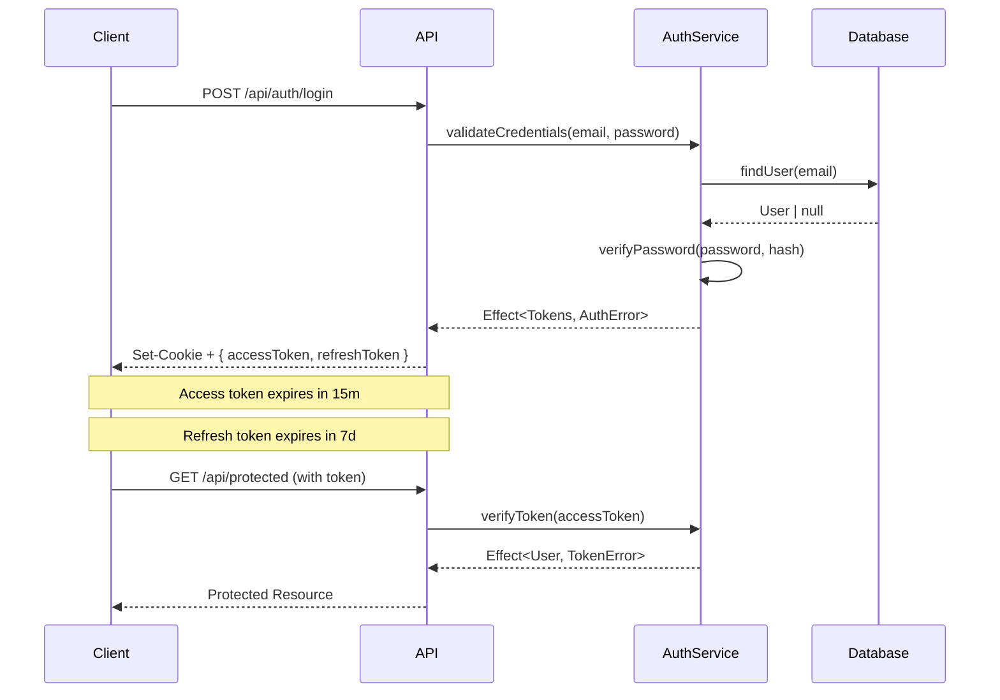

# Application Documentation

This directory contains **detailed documentation for all features and significant changes** made to the application.

## Purpose

When AI agents or developers implement features, fix bugs, or make significant changes to the system, they **must document their work here** with the precision and thoroughness of a German technical manual.

## Structure

Each feature, bug fix, or significant change gets its own directory:

```
docs/app/[feature-name]/
├── README.md           # Overview, purpose, usage examples
├── architecture.md     # Design decisions, trade-offs, alternatives considered
├── implementation.md   # Technical details, key files, integration points
└── diagrams/          # Mermaid diagrams for visual clarity
    ├── flow.md        # Data flow, control flow, sequence diagrams
    └── structure.md   # Component structure, module dependencies
```

## Documentation Standards

### Precision

- Every detail matters - write like a German technical manual
- Be explicit, not implicit - future maintainers don't know your context
- Document the **why**, not just the **what** (code shows what, docs explain why)

### Visual Clarity

- **Always include Mermaid diagrams** for architecture and flow
- System diagrams for component relationships
- Sequence diagrams for interactions
- Flow charts for decision logic

### Trade-offs

- Document **alternatives considered** and why they were rejected
- Explain **design decisions** and their implications
- Note **limitations** and potential future improvements

### Maintainability

- Write for someone who knows nothing about your change
- Link to related documentation in `docs/guides/` and `docs/architecture/`
- Reference specific file paths and line numbers where relevant

## Examples

### Good Feature Documentation

**docs/app/user-authentication/**

```
user-authentication/
├── README.md           # What: JWT-based auth with refresh tokens
│                       # Why: Stateless, scalable, works with SSR
│                       # Usage: Login, logout, protected routes
│
├── architecture.md     # Decision: JWT over sessions (why?)
│                       # Trade-off: Token size vs database queries
│                       # Security: HTTPS-only, HttpOnly cookies
│
├── implementation.md   # Files: src/lib/auth.ts, src/routes/api/auth/
│                       # Integration: Effect services, middleware
│                       # Testing: Auth flow tests, token validation
│
└── diagrams/
    ├── flow.md        # Sequence: Login → Token → Refresh → Logout
    └── structure.md   # Components: AuthService, TokenValidator, etc.
```

### Mermaid Diagram Example

From `diagrams/flow.md`:

````markdown
# Authentication Flow


````

## When to Document

### Always Document

- ✅ New features (authentication, payments, API integrations)
- ✅ Significant refactors (state management changes, architecture shifts)
- ✅ Complex bug fixes (root cause analysis, solution explanation)
- ✅ Performance optimizations (before/after, trade-offs)
- ✅ Integration with external services (APIs, databases, analytics)

### Optional (but encouraged)

- Minor bug fixes with interesting root causes
- Utility functions with non-obvious behavior
- Configuration changes with important implications

### Skip

- Trivial changes (typos, formatting)
- Self-explanatory code additions
- Changes already covered in existing docs

## Related Documentation

- **System Architecture**: `docs/architecture/overview.md`
- **Code Quality Standards**: `docs/guides/code-quality.md`
- **Testing Patterns**: `docs/guides/testing.md`
- **Performance Guidelines**: `docs/guides/performance-monitoring.md`

---

**Remember**: You are not just writing code. You are maintaining a system. Document with the precision of a German engineering manual.
