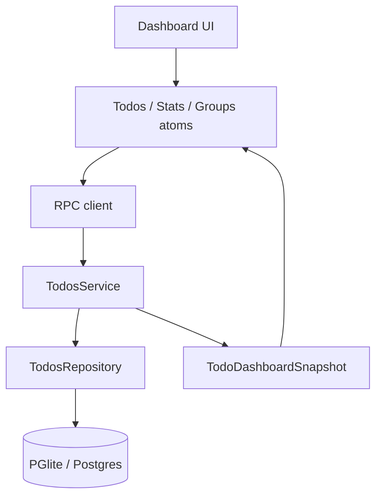
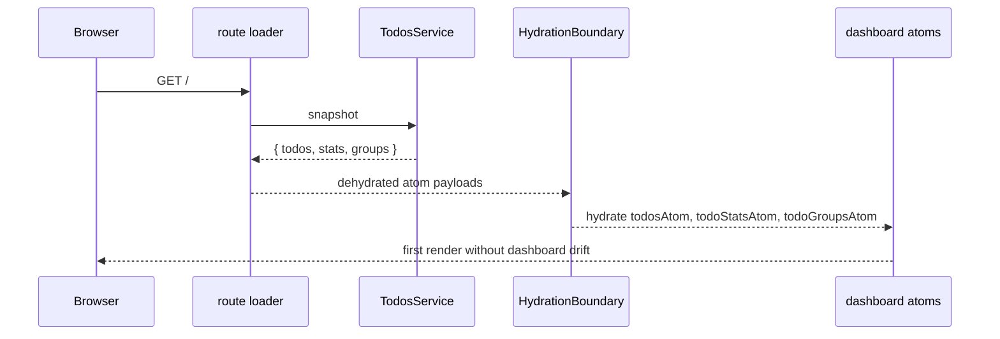
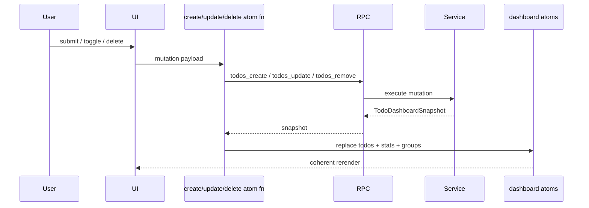

# Todo Dashboard

## Overview

The home route restores the richer todo sample instead of a flat CRUD list.
It exists to demonstrate three things at once:

1. **server-derived dashboard read models**
2. **SSR hydration of multiple atoms from one snapshot**
3. **single-flight mutation coherence across list, stats, and grouped views**

The dashboard now supports:

- due dates
- overdue, today, upcoming, unscheduled, and completed classification
- summary cards
- grouped board filters
- recent activity
- snapshot-returning mutations

## Why this sample is intentionally richer

A plain todo list is too small to show how the stack behaves once multiple read
models depend on the same mutation.

This dashboard is the smallest sample in the repository that still proves:

- repository persistence and migration behavior
- domain classification rules
- RPC and HTTP parity
- hydration of multiple atoms on first render
- client-side synchronization without duplicating server derivation logic

## Core design decisions

### Snapshot mutations instead of local client recomputation

`create`, `update`, and `remove` return a `TodoDashboardSnapshot`.
The client writes that snapshot into all dashboard atoms.

Why:

- stats and grouping must stay coherent
- classification logic lives on the server once
- the UI does not risk drifting from the service rules

### UTC date strings for due dates

Due dates use `YYYY-MM-DD` strings and are interpreted as UTC calendar days.
This avoids local timezone drift when comparing or formatting due dates.

### Unscheduled is explicit

The previous dashboard implementation treated null due dates ambiguously.
The restored version makes them first-class:

- they count toward `active`
- they count toward `unscheduled`
- they render in an `Unscheduled` group
- they are not mixed into `upcoming`

This keeps stats and grouping logically aligned.

## Data flow

## Initial page load

## Mutation flow

## Key files

- `src/api/todo-schema.ts`
  - dashboard-capable todo domain types
- `src/db/schema.ts`
  - `due_date` and `updated_at` persistence columns
- `src/db/todos-repository.ts`
  - CRUD persistence and compatibility migrations
- `src/routes/api/-lib/todos-service.ts`
  - canonical ordering, classification, stats, groups, snapshot derivation
- `src/routes/-index/atoms.tsx`
  - dashboard atoms and snapshot mutation writes
- `src/routes/index.tsx`
  - SSR hydration of all dashboard read models
- `src/routes/-index/*.tsx`
  - dashboard surfaces composed from the current design system

## Classification invariants

For every snapshot:

- `stats.total === todos.length`
- `stats.completed === completed group count`
- `stats.overdue === overdue group count`
- `stats.dueToday === today group count`
- `stats.upcoming === upcoming group count`
- `stats.unscheduled === unscheduled group count`
- every todo appears in exactly one group

Those invariants are verified in `src/routes/api/-lib/todos-service.test.ts`.
