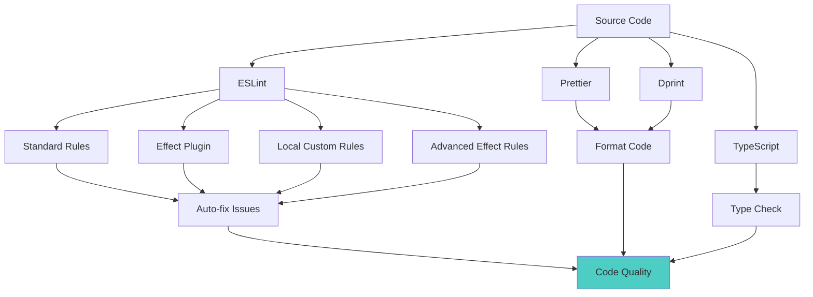

# Code Quality Guide

Complete guide to linting, formatting, and code quality tools in the Effect TanStack Start project.

## Overview



This guide covers:
- ESLint configuration with Effect-specific rules
- Custom local ESLint rules for Effect patterns
- Prettier configuration
- Dprint configuration
- Code quality scripts
- Pre-commit hooks setup
- CI/CD integration

---

## Tools Overview

### 1. ESLint

ESLint enforces code quality and consistency with:
- Standard TypeScript rules
- Effect-specific patterns from `@effect/eslint-plugin`
- Custom local rules for Effect.gen patterns
- Import sorting and organization

### 2. Prettier

Prettier handles basic code formatting:
- No semicolons
- 120 character line width
- No trailing commas

### 3. Dprint

Dprint provides advanced formatting:
- Effect-integrated via `@effect/dprint`
- TypeScript, JSON, Markdown, SQL, TOML, CSS
- Consistent 80-character line width
- ASI (Automatic Semicolon Insertion)

### 4. TypeScript

TypeScript ensures type safety:
- Strict mode enabled
- No implicit any
- Consistent type imports

---

## Quick Start

### Install Dependencies

```bash
bun install
```

All linting and formatting dependencies are included in `package.json`.

### Run Linting

```bash
# Check for linting errors
bun run lint

# Auto-fix linting errors
bun run lint:fix
```

### Run Formatting

```bash
# Format with Prettier
bun run format

# Check formatting without changing files
bun run format:check

# Format with Dprint
bun run dprint:format

# Check Dprint formatting
bun run dprint:check
```

### Type Checking

```bash
# Check TypeScript types
bun run typecheck
```

---

## ESLint Configuration

### Configuration File

**File:** `eslint.config.js`

The ESLint configuration uses the new flat config format:

```javascript
import effectPlugin from "@effect/eslint-plugin"
import { fixupPluginRules } from "@eslint/compat"
import { FlatCompat } from "@eslint/eslintrc"
import js from "@eslint/js"
import tsParser from "@typescript-eslint/parser"

export default [
  {
    ignores: [
      "**/dist",
      "**/build",
      "**/docs",
      "**/*.md",
      "**/*.cjs",
      "**/*.js",
    ],
  },
  // ... rest of config
]
```

### Enabled Rules

#### Standard Rules

- **camelcase**: Enforce camelCase naming
- **max-lines**: Max 500 lines per file
- **complexity**: Max cyclomatic complexity of 20
- **max-depth**: Max nesting depth of 4
- **max-lines-per-function**: Max 150 lines per function
- **eqeqeq**: Require === and !==
- **prefer-template**: Use template literals
- **curly**: Require curly braces
- **dot-notation**: Use dot notation when possible

#### TypeScript Rules

- **@typescript-eslint/array-type**: Use `Array<T>` syntax
- **@typescript-eslint/consistent-type-imports**: Prefer type imports
- **@typescript-eslint/no-unused-vars**: Error on unused variables (except `_` prefixed)

#### Effect Rules

- **@effect/no-import-from-barrel-package**: Prevent imports from barrel files
- **@effect/dprint**: Enforce Effect formatting standards

#### Import Rules

- **import/first**: Imports must come first
- **import/newline-after-import**: Blank line after imports
- **import/no-duplicates**: No duplicate imports
- **sort-destructure-keys/sort-destructure-keys**: Sort destructured keys

---

## Custom Local Rules

### Basic Local Rules

**File:** `eslint-local-rules.cjs`

#### no-opaque-instance-fields

Prevents instance fields in classes extending `Schema.Opaque(...)`:

```typescript
// ❌ Bad - instance field in Opaque class
class UserId extends Schema.Opaque("UserId")(Schema.String) {
  name: string // ERROR: No instance fields allowed
}

// ✅ Good - no instance fields
class UserId extends Schema.Opaque("UserId")(Schema.String) {
  static make(value: string) {
    return value as UserId
  }
}
```

### Advanced Local Rules

**File:** `eslint-local-rules-advanced.cjs`

#### no-try-catch-in-effect-gen

Prevents try-catch blocks inside Effect.gen:

```typescript
// ❌ Bad - try-catch in Effect.gen
const program = Effect.gen(function* () {
  try {
    const result = yield* someEffect
  } catch (error) {
    console.error(error)
  }
})

// ✅ Good - use Effect error handling
const program = Effect.gen(function* () {
  const result = yield* Effect.tryPromise(() => someAsyncOperation())
})
```

#### no-type-assertions

Prevents dangerous type assertions:

```typescript
// ❌ Bad - dangerous type assertions
const value = something as any
const value2 = something as never
const value3 = something as unknown

// ✅ Good - proper typing
const value: SomeType = something
```

#### require-return-yield-for-errors

Requires `return yield*` pattern for terminal effects:

```typescript
// ❌ Bad - missing return
const program = Effect.gen(function* () {
  if (condition) {
    yield* Effect.fail(new Error("Failed"))
  }
})

// ✅ Good - return yield* for terminal effects
const program = Effect.gen(function* () {
  if (condition) {
    return yield* Effect.fail(new Error("Failed"))
  }
})
```

#### no-effect-runsync-in-gen

Prevents Effect.runSync inside Effect.gen:

```typescript
// ❌ Bad - runSync inside generator
const program = Effect.gen(function* () {
  const result = Effect.runSync(otherEffect) // ERROR
})

// ✅ Good - use yield*
const program = Effect.gen(function* () {
  const result = yield* otherEffect
})
```

#### prefer-effect-constructors

Suggests Effect equivalents for native constructors:

```typescript
// ⚠️ Warning - prefer Effect version
const arr = Array.from(iterable)

// ✅ Good - use Effect constructor
const arr = Array.fromIterable(iterable)
```

---

## Prettier Configuration

**File:** `.prettierrc`

```json
{
  "semi": false,
  "printWidth": 120,
  "trailingComma": "none"
}
```

### Prettier Settings

- **semi**: No semicolons (use ASI)
- **printWidth**: 120 characters max
- **trailingComma**: Never add trailing commas

### Usage

```bash
# Format all files
bun run format

# Check formatting
bun run format:check

# Format specific file
bunx prettier --write src/my-file.ts
```

---

## Dprint Configuration

**File:** `dprint.json`

```json
{
  "$schema": "https://dprint.dev/schemas/v0.json",
  "indentWidth": 2,
  "lineWidth": 80,
  "newLineKind": "lf",
  "typescript": {
    "semiColons": "asi",
    "binaryExpression.linePerExpression": true,
    "preferSingleLine": false,
    "jsx.forceNewLinesSurroundingContent": true,
    "memberExpression.linePerExpression": true,
    "enumDeclaration.memberSpacing": "newLine",
    "exportDeclaration.forceMultiLine": "always",
    "importDeclaration.preferSingleLine": true
  }
}
```

### Dprint Plugins

- TypeScript/JavaScript
- JSON
- Markdown
- TOML
- CSS (Malva)
- Markup (HTML/XML)
- SQL

### Usage

```bash
# Format all files
bun run dprint:format

# Check formatting
bun run dprint:check

# Format specific file
bunx dprint fmt src/my-file.ts
```

---

## Code Quality Workflow

### During Development

```bash
# 1. Write code
# 2. Auto-format on save (configure in your editor)
# 3. Run type check
bun run typecheck

# 4. Run linter
bun run lint:fix

# 5. Commit changes
git add .
git commit -m "feat: add new feature"
```

### Before Committing

```bash
# Run all quality checks
bun run typecheck && bun run lint && bun run format:check
```

### Pre-commit Hook (Recommended)

Install Husky and lint-staged:

```bash
bun add -d husky lint-staged
bunx husky init
```

Create `.husky/pre-commit`:

```bash
#!/usr/bin/env sh
. "$(dirname -- "$0")/_/husky.sh"

bunx lint-staged
```

Create `lint-staged.config.js`:

```javascript
export default {
  "*.{ts,tsx}": [
    "eslint --fix",
    "prettier --write",
    "dprint fmt",
  ],
  "*.{json,md}": [
    "prettier --write",
    "dprint fmt",
  ],
}
```

---

## Editor Integration

### VS Code

Create `.vscode/settings.json`:

```json
{
  "editor.formatOnSave": true,
  "editor.defaultFormatter": "esbenp.prettier-vscode",
  "editor.codeActionsOnSave": {
    "source.fixAll.eslint": true
  },
  "eslint.validate": [
    "javascript",
    "javascriptreact",
    "typescript",
    "typescriptreact"
  ],
  "typescript.tsdk": "node_modules/typescript/lib"
}
```

Install extensions:

- ESLint (`dbaeumer.vscode-eslint`)
- Prettier (`esbenp.prettier-vscode`)
- Dprint (`dprint.dprint`)

### IntelliJ IDEA / WebStorm

1. **Enable ESLint:**
   - Preferences → Languages & Frameworks → JavaScript → Code Quality Tools → ESLint
   - Select "Automatic ESLint configuration"
   - Check "Run eslint --fix on save"

2. **Enable Prettier:**
   - Preferences → Languages & Frameworks → JavaScript → Prettier
   - Select "On code reformat" and "On save"

---

## CI/CD Integration

### GitHub Actions

Create `.github/workflows/quality.yml`:

```yaml
name: Code Quality

on:
  pull_request:
  push:
    branches: [main]

jobs:
  quality:
    runs-on: ubuntu-latest

    steps:
      - uses: actions/checkout@v4

      - uses: oven-sh/setup-bun@v2
        with:
          bun-version: latest

      - name: Install dependencies
        run: bun install

      - name: Type check
        run: bun run typecheck

      - name: Lint
        run: bun run lint

      - name: Format check
        run: bun run format:check

      - name: Dprint check
        run: bun run dprint:check

      - name: Run tests
        run: bun run test
```

---

## Common Patterns

### Effect.gen Best Practices

```typescript
// ✅ Good - proper Effect.gen usage
const program = Effect.gen(function* () {
  // Use yield* for effects
  const user = yield* fetchUser(id)

  // Use Effect error handling
  const result = yield* Effect.tryPromise({
    try: () => fetch("/api/data"),
    catch: (error) => new FetchError(error),
  })

  // Return yield* for terminal effects
  if (!result.ok) {
    return yield* Effect.fail(new Error("Request failed"))
  }

  // Use Effect.log for logging
  yield* Effect.log(`User: ${user.name}`)

  return result
})
```

### Type Safety

```typescript
// ✅ Good - explicit typing
interface User {
  id: number
  name: string
}

const fetchUser = (id: number): Effect.Effect<User, FetchError> =>
  Effect.gen(function* () {
    const response = yield* Effect.tryPromise(() =>
      fetch(`/api/users/${id}`)
    )
    const user: User = yield* Effect.tryPromise(() => response.json())
    return user
  })
```

### Import Organization

```typescript
// ✅ Good - organized imports
import type { User } from "./types"
import { Effect, Layer } from "effect"
import { fetchUser } from "./api"
```

---

## Troubleshooting

### ESLint Not Running

```bash
# Check ESLint is installed
bun pm ls eslint

# Run with debug
DEBUG=eslint:* bun run lint
```

### Prettier Conflicts with ESLint

The configs are designed to work together. Prettier handles formatting, ESLint handles code quality.

If conflicts occur:
1. Run Prettier first: `bun run format`
2. Then run ESLint: `bun run lint:fix`

### Dprint Performance

Dprint is very fast, but for large codebases:

```bash
# Format incrementally
bunx dprint fmt --incremental
```

### Custom Rule Errors

To disable a custom rule temporarily:

```typescript
/* eslint-disable local-advanced/no-try-catch-in-effect-gen */
const program = Effect.gen(function* () {
  try {
    // ...
  } catch (e) {
    // ...
  }
})
/* eslint-enable local-advanced/no-try-catch-in-effect-gen */
```

---

## Custom Rule Development

### Adding New Local Rules

Edit `eslint-local-rules.cjs` or `eslint-local-rules-advanced.cjs`:

```javascript
module.exports = {
  "my-custom-rule": {
    meta: {
      type: "problem",
      docs: {
        description: "My custom rule description",
        category: "Best Practices",
        recommended: true,
      },
      schema: [],
      messages: {
        myMessage: "Error message here",
      },
    },
    create(context) {
      return {
        // AST node visitors
        CallExpression(node) {
          // Check conditions
          if (shouldReport) {
            context.report({
              node,
              messageId: "myMessage",
            })
          }
        },
      }
    },
  },
}
```

Enable in `eslint.config.js`:

```javascript
{
  rules: {
    "local/my-custom-rule": "error",
  }
}
```

---

## Resources

- [ESLint Documentation](https://eslint.org)
- [Prettier Documentation](https://prettier.io)
- [Dprint Documentation](https://dprint.dev)
- [Effect ESLint Plugin](https://github.com/Effect-TS/eslint-plugin)
- [TypeScript ESLint](https://typescript-eslint.io)

---

## Best Practices Summary

1. **Run linting before commits** - Catch issues early
2. **Use auto-fix** - `bun run lint:fix` saves time
3. **Enable editor integration** - Real-time feedback
4. **Follow Effect patterns** - Let custom rules guide you
5. **Keep functions small** - Max 150 lines per function
6. **Use type imports** - `import type { ... }`
7. **No type assertions** - Fix underlying type issues
8. **Use Effect error handling** - No try-catch in Effect.gen
9. **Consistent formatting** - Run format tools regularly
10. **Type everything** - No `any` types

---

**Ready to maintain high code quality?** Run `bun run lint && bun run format` to get started!
