# SQLite with Drizzle Guide

Complete guide to adding SQLite with Drizzle ORM to your Effect TanStack Start application.

## Overview

```mermaid
graph TB
    App[Application] --> Drizzle[Drizzle ORM]
    Drizzle --> SQLite[(SQLite Database)]

    subgraph "File System"
        SQLite --> File[database.sqlite]
    end

    subgraph "Effect Integration"
        Effect[Effect Service] --> Drizzle
    end

    style SQLite fill:#003B57
    style Drizzle fill:#C5F74F
```



This guide covers:

- Installing SQLite and Drizzle dependencies
- Setting up database schema
- Configuring SQLite connection
- Integrating with Effect-TS
- Running migrations
- Development vs Production setup
- Best practices

---

## Installation

### 1. Install Dependencies

```bash
# Core SQLite and Drizzle packages
bun add drizzle-orm better-sqlite3
bun add -d drizzle-kit @types/better-sqlite3

# Optional: Effect SQL integration
bun add @effect/sql @effect/sql-drizzle
```

**Package Purposes:**

- `drizzle-orm` - TypeScript ORM with type-safe queries
- `better-sqlite3` - Fast, synchronous SQLite3 driver for Node.js/Bun
- `drizzle-kit` - CLI for migrations and schema management
- `@types/better-sqlite3` - TypeScript definitions
- `@effect/sql` - Effect-based SQL client (optional)
- `@effect/sql-drizzle` - Drizzle integration for Effect

---

## Project Structure

Create the following structure for database code:

```
src/
├── db/
│   ├── schema/
│   │   ├── users.ts          # User table schema
│   │   ├── posts.ts          # Post table schema
│   │   └── index.ts          # Export all schemas
│   ├── migrations/           # Generated migration files
│   ├── client.ts             # Database client setup
│   ├── layer.ts              # Effect layer for DI
│   └── seed.ts               # Seed data script
├── drizzle.config.ts         # Drizzle Kit configuration
├── data/                     # SQLite database files
│   ├── .gitkeep
│   └── database.sqlite       # Production database
└── .env                      # Environment variables
```

Add to `.gitignore`:

```gitignore
# SQLite databases
data/*.sqlite
data/*.sqlite-shm
data/*.sqlite-wal

# Keep directory structure
!data/.gitkeep
```

---

## Configuration

### 1. Environment Variables

Add to `.env`:

```bash
# SQLite Database Path
DATABASE_PATH="./data/database.sqlite"

# SQLite Configuration
SQLITE_WAL_MODE="true"           # Write-Ahead Logging
SQLITE_TIMEOUT="5000"            # Busy timeout in ms
SQLITE_CACHE_SIZE="2000"         # Cache size in pages
```

Add to `.env.test`:

```bash
# Test database (in-memory or separate file)
DATABASE_PATH=":memory:"
# Or use a separate test file
# DATABASE_PATH="./data/test.sqlite"
```

Add to `.env.docker`:

```bash
# Docker SQLite (persisted via volume)
DATABASE_PATH="/app/data/database.sqlite"
SQLITE_WAL_MODE="true"
```

### 2. Drizzle Configuration

Create `drizzle.config.ts` in project root:

```typescript
import type { Config } from "drizzle-kit"

export default {
  schema: "./src/db/schema/index.ts",
  out: "./src/db/migrations",
  dialect: "sqlite",
  dbCredentials: {
    url: process.env.DATABASE_PATH || "./data/database.sqlite",
  },
  verbose: true,
  strict: true,
} satisfies Config
```

### 3. Create Data Directory

```bash
mkdir -p data
touch data/.gitkeep
```

---

## Schema Definition

### 1. Define Tables

Create `src/db/schema/users.ts`:

```typescript
import { sql } from "drizzle-orm"
import { integer, sqliteTable, text } from "drizzle-orm/sqlite-core"

export const users = sqliteTable("users", {
  id: integer("id").primaryKey({ autoIncrement: true }),
  email: text("email").notNull().unique(),
  name: text("name").notNull(),
  passwordHash: text("password_hash").notNull(),
  createdAt: integer("created_at", { mode: "timestamp" })
    .notNull()
    .default(sql`(unixepoch())`),
  updatedAt: integer("updated_at", { mode: "timestamp" })
    .notNull()
    .default(sql`(unixepoch())`),
})

export type User = typeof users.$inferSelect
export type NewUser = typeof users.$inferInsert
```

Create `src/db/schema/posts.ts`:

```typescript
import { sql } from "drizzle-orm"
import { integer, sqliteTable, text } from "drizzle-orm/sqlite-core"
import { users } from "./users"

export const posts = sqliteTable("posts", {
  id: integer("id").primaryKey({ autoIncrement: true }),
  title: text("title").notNull(),
  content: text("content").notNull(),
  authorId: integer("author_id")
    .notNull()
    .references(() => users.id, { onDelete: "cascade" }),
  published: integer("published", { mode: "timestamp" }),
  createdAt: integer("created_at", { mode: "timestamp" })
    .notNull()
    .default(sql`(unixepoch())`),
  updatedAt: integer("updated_at", { mode: "timestamp" })
    .notNull()
    .default(sql`(unixepoch())`),
})

export type Post = typeof posts.$inferSelect
export type NewPost = typeof posts.$inferInsert
```

Create `src/db/schema/index.ts`:

```typescript
export * from "./posts"
export * from "./users"
```

### 2. SQLite-Specific Considerations

**Timestamps in SQLite:**

SQLite doesn't have a native timestamp type. Use:

```typescript
// Option 1: Unix timestamp (seconds)
integer("created_at", { mode: "timestamp" })

// Option 2: ISO 8601 string
text("created_at")

// Option 3: Unix timestamp in milliseconds
integer("created_at", { mode: "number" })
```

**Boolean Values:**

```typescript
// SQLite doesn't have boolean type - use integer
integer("is_active", { mode: "boolean" }).notNull().default(true)
```

**JSON Data:**

```typescript
// Store JSON as text
text("metadata", { mode: "json" }).$type<{ key: string; value: number }>()
```

---

## Database Client Setup

### Option A: Standard Drizzle Client

Create `src/db/client.ts`:

```typescript
import Database from "better-sqlite3"
import { drizzle } from "drizzle-orm/better-sqlite3"
import fs from "fs"
import path from "path"
import * as schema from "./schema"

// Ensure data directory exists
const databasePath = process.env.DATABASE_PATH || "./data/database.sqlite"

if (databasePath !== ":memory:") {
  const dir = path.dirname(databasePath)
  if (!fs.existsSync(dir)) {
    fs.mkdirSync(dir, { recursive: true })
  }
}

// Create SQLite connection
const sqlite = new Database(databasePath, {
  verbose: process.env.NODE_ENV === "development"
    ? console.log
    : undefined,
})

// Configure SQLite
sqlite.pragma("journal_mode = WAL") // Write-Ahead Logging
sqlite.pragma("synchronous = NORMAL")
sqlite.pragma("cache_size = -2000") // 2MB cache
sqlite.pragma("temp_store = MEMORY")
sqlite.pragma("busy_timeout = 5000")

// Enable foreign keys
sqlite.pragma("foreign_keys = ON")

// Create Drizzle instance
export const db = drizzle(sqlite, { schema })

// Export SQLite instance for raw queries if needed
export {
  sqlite,
}

// Export types
export type Database = typeof db
```

### Option B: Effect-Based Client (Recommended)

Create `src/db/client.ts`:

```typescript
import Database from "better-sqlite3"
import { drizzle } from "drizzle-orm/better-sqlite3"
import { Context, Effect, Layer } from "effect"
import fs from "fs"
import path from "path"
import * as schema from "./schema"

// Database service tag
export class DatabaseService extends Context.Tag("DatabaseService")<
  DatabaseService,
  {
    readonly db: ReturnType<typeof drizzle>
    readonly sqlite: Database.Database
  }
>() {}

// Create database layer
export const DatabaseLive = Layer.scoped(
  DatabaseService,
  Effect.gen(function*() {
    const databasePath = process.env.DATABASE_PATH || "./data/database.sqlite"

    // Ensure data directory exists
    if (databasePath !== ":memory:") {
      const dir = path.dirname(databasePath)
      yield* Effect.sync(() => {
        if (!fs.existsSync(dir)) {
          fs.mkdirSync(dir, { recursive: true })
        }
      })
    }

    // Create SQLite connection
    const sqlite = yield* Effect.sync(() =>
      new Database(databasePath, {
        verbose: process.env.NODE_ENV === "development"
          ? console.log
          : undefined,
      })
    )

    // Configure SQLite
    yield* Effect.sync(() => {
      sqlite.pragma("journal_mode = WAL")
      sqlite.pragma("synchronous = NORMAL")
      sqlite.pragma("cache_size = -2000")
      sqlite.pragma("temp_store = MEMORY")
      sqlite.pragma("busy_timeout = 5000")
      sqlite.pragma("foreign_keys = ON")
    })

    yield* Effect.log(`SQLite database initialized: ${databasePath}`)

    // Create Drizzle instance
    const db = drizzle(sqlite, { schema })

    // Cleanup on scope close
    yield* Effect.addFinalizer(() => Effect.sync(() => sqlite.close()))

    return { db, sqlite }
  }),
)

// Helper to get database instance
export const getDatabase = Effect.gen(function*() {
  const { db } = yield* DatabaseService
  return db
})
```

Create `src/db/layer.ts`:

```typescript
import { Layer } from "effect"
import { DatabaseLive } from "./client"

// Combine all database layers
export const DatabaseLayer = DatabaseLive

// Export for use in application
export {
  DatabaseService,
} from "./client"
```

---

## Migrations

### 1. Generate Migration

```bash
# Generate migration from schema changes
bunx drizzle-kit generate

# This creates a new SQL file in src/db/migrations/
# Example: src/db/migrations/0000_initial.sql
```

### 2. Apply Migrations

Create `src/db/migrate.ts`:

```typescript
import Database from "better-sqlite3"
import { drizzle } from "drizzle-orm/better-sqlite3"
import { migrate } from "drizzle-orm/better-sqlite3/migrator"
import fs from "fs"
import path from "path"

async function runMigrations() {
  const databasePath = process.env.DATABASE_PATH || "./data/database.sqlite"

  // Ensure data directory exists
  if (databasePath !== ":memory:") {
    const dir = path.dirname(databasePath)
    if (!fs.existsSync(dir)) {
      fs.mkdirSync(dir, { recursive: true })
    }
  }

  // Create connection for migrations
  const sqlite = new Database(databasePath)
  sqlite.pragma("journal_mode = WAL")
  sqlite.pragma("foreign_keys = ON")

  const db = drizzle(sqlite)

  console.log("Running migrations...")

  migrate(db, {
    migrationsFolder: "./src/db/migrations",
  })

  console.log("Migrations completed!")

  sqlite.close()
}

runMigrations().catch((error) => {
  console.error("Migration failed:", error)
  process.exit(1)
})
```

Add scripts to `package.json`:

```json
{
  "scripts": {
    "db:generate": "drizzle-kit generate",
    "db:migrate": "bun run src/db/migrate.ts",
    "db:studio": "drizzle-kit studio",
    "db:push": "drizzle-kit push",
    "db:seed": "bun run src/db/seed.ts",
    "db:reset": "rm -f data/database.sqlite* && bun run db:migrate && bun run db:seed"
  }
}
```

### 3. Run Migrations

```bash
# Generate migration files
bun run db:generate

# Apply migrations to database
bun run db:migrate

# Open Drizzle Studio (GUI)
bun run db:studio

# Reset database (delete + migrate + seed)
bun run db:reset
```

---

## Usage Examples

### Basic CRUD Operations

```typescript
import { and, eq, like } from "drizzle-orm"
import { db } from "./db/client"
import { posts, users } from "./db/schema"

// CREATE
const newUser = db
  .insert(users)
  .values({
    email: "john@example.com",
    name: "John Doe",
    passwordHash: "...",
  })
  .returning()
  .get()

// READ - Single record
const user = db.query.users.findFirst({
  where: eq(users.id, 1),
})

// READ - Multiple records
const allUsers = db.query.users.findMany()

// READ - With relations
const userWithPosts = db.query.users.findFirst({
  where: eq(users.id, 1),
  with: {
    posts: true,
  },
})

// UPDATE
db
  .update(users)
  .set({ name: "Jane Doe", updatedAt: new Date() })
  .where(eq(users.id, 1))
  .run()

// DELETE
db.delete(users).where(eq(users.id, 1)).run()

// Complex query
const searchResults = db.query.users.findMany({
  where: and(
    like(users.email, "%@example.com"),
    eq(users.name, "John Doe"),
  ),
  limit: 10,
  offset: 0,
})
```

### Effect-Based Operations

Create `src/db/repositories/users.ts`:

```typescript
import { eq } from "drizzle-orm"
import { Effect } from "effect"
import { DatabaseService } from "../layer"
import { type NewUser, type User, users } from "../schema/users"

export const UserRepository = {
  create: (data: NewUser) =>
    Effect.gen(function*() {
      const { db } = yield* DatabaseService
      const user = yield* Effect.sync(() =>
        db.insert(users).values(data).returning().get()
      )
      return user
    }),

  findById: (id: number) =>
    Effect.gen(function*() {
      const { db } = yield* DatabaseService
      const user = yield* Effect.sync(() =>
        db.query.users.findFirst({
          where: eq(users.id, id),
        })
      )
      if (!user) {
        return yield* Effect.fail(new Error("User not found"))
      }
      return user
    }),

  findByEmail: (email: string) =>
    Effect.gen(function*() {
      const { db } = yield* DatabaseService
      return yield* Effect.sync(() =>
        db.query.users.findFirst({
          where: eq(users.email, email),
        })
      )
    }),

  update: (id: number, data: Partial<NewUser>) =>
    Effect.gen(function*() {
      const { db } = yield* DatabaseService
      const updated = yield* Effect.sync(() =>
        db
          .update(users)
          .set({ ...data, updatedAt: new Date() })
          .where(eq(users.id, id))
          .returning()
          .get()
      )
      return updated
    }),

  delete: (id: number) =>
    Effect.gen(function*() {
      const { db } = yield* DatabaseService
      yield* Effect.sync(() => db.delete(users).where(eq(users.id, id)).run())
    }),

  list: (limit = 10, offset = 0) =>
    Effect.gen(function*() {
      const { db } = yield* DatabaseService
      return yield* Effect.sync(() =>
        db.query.users.findMany({ limit, offset })
      )
    }),
}
```

Usage in application:

```typescript
import { Effect } from "effect"
import { DatabaseLayer } from "./db/layer"
import { UserRepository } from "./db/repositories/users"

const program = Effect.gen(function*() {
  // Create user
  const user = yield* UserRepository.create({
    email: "john@example.com",
    name: "John Doe",
    passwordHash: "hashed_password",
  })

  yield* Effect.log(`Created user: ${user.id}`)

  // Find user
  const foundUser = yield* UserRepository.findById(user.id)
  yield* Effect.log(`Found user: ${foundUser.email}`)

  // Update user
  yield* UserRepository.update(user.id, { name: "Jane Doe" })

  // List users
  const users = yield* UserRepository.list(10, 0)
  yield* Effect.log(`Total users: ${users.length}`)
})

// Run with database layer
Effect.runPromise(program.pipe(Effect.provide(DatabaseLayer)))
```

---

## Docker Setup

### 1. Update Dockerfile

Add volume for SQLite database:

```dockerfile
FROM oven/bun:1 AS base
WORKDIR /app

# Create data directory
RUN mkdir -p /app/data

FROM base AS development
COPY --from=deps /app/node_modules ./node_modules
COPY . .

# Create volume mount point
VOLUME /app/data

EXPOSE 3000
CMD ["bun", "run", "dev"]

FROM base AS production
ENV NODE_ENV=production
COPY --from=builder /app/.output ./.output
COPY --from=builder /app/data ./data

# Create volume mount point
VOLUME /app/data

EXPOSE 3000
CMD ["bun", "run", ".output/server/index.mjs"]
```

### 2. Update docker-compose.yml

```yaml
services:
  app:
    build:
      context: .
      target: development
    ports:
      - "3000:3000"
    volumes:
      - .:/app
      - /app/node_modules
      - sqlite_data:/app/data  # Persist SQLite database
    environment:
      - DATABASE_PATH=/app/data/database.sqlite
      - SQLITE_WAL_MODE=true
    networks:
      - app-network

volumes:
  sqlite_data:
    driver: local

networks:
  app-network:
    driver: bridge
```

### 3. Run Migrations in Docker

```bash
# Start app
docker-compose up -d app

# Run migrations
docker-compose exec app bun run db:migrate

# Seed database
docker-compose exec app bun run db:seed

# Access SQLite shell
docker-compose exec app sqlite3 /app/data/database.sqlite
```

---

## Database Seeding

Create `src/db/seed.ts`:

```typescript
import { db } from "./client"
import { posts, users } from "./schema"

function seed() {
  console.log("Seeding database...")

  // Clear existing data (in order due to foreign keys)
  db.delete(posts).run()
  db.delete(users).run()

  // Create users
  const user1 = db
    .insert(users)
    .values({
      email: "alice@example.com",
      name: "Alice Johnson",
      passwordHash: "hashed_password_1",
    })
    .returning()
    .get()

  const user2 = db
    .insert(users)
    .values({
      email: "bob@example.com",
      name: "Bob Smith",
      passwordHash: "hashed_password_2",
    })
    .returning()
    .get()

  console.log(`Created 2 users`)

  // Create posts
  db
    .insert(posts)
    .values([
      {
        title: "First Post",
        content: "This is Alice's first post",
        authorId: user1.id,
        published: new Date(),
      },
      {
        title: "Second Post",
        content: "This is Alice's second post",
        authorId: user1.id,
      },
      {
        title: "Bob's Post",
        content: "This is Bob's post",
        authorId: user2.id,
        published: new Date(),
      },
    ])
    .run()

  console.log(`Created 3 posts`)
  console.log("Seeding completed!")
}

seed()
```

Run seeding:

```bash
bun run db:seed
```

---

## Testing with SQLite

### 1. In-Memory Database for Tests

Update `.env.test`:

```bash
# Use in-memory database for fast tests
DATABASE_PATH=":memory:"
```

### 2. Test Utilities

Create `src/db/test-utils.ts`:

```typescript
import Database from "better-sqlite3"
import { drizzle } from "drizzle-orm/better-sqlite3"
import { migrate } from "drizzle-orm/better-sqlite3/migrator"
import { Effect, Layer } from "effect"
import { DatabaseService } from "./layer"
import * as schema from "./schema"

// Create test database layer (in-memory)
export const TestDatabaseLayer = Layer.scoped(
  DatabaseService,
  Effect.gen(function*() {
    // Create in-memory SQLite database
    const sqlite = yield* Effect.sync(() => new Database(":memory:"))

    // Configure SQLite
    yield* Effect.sync(() => {
      sqlite.pragma("foreign_keys = ON")
      sqlite.pragma("synchronous = OFF") // Faster for tests
      sqlite.pragma("journal_mode = MEMORY")
    })

    const db = drizzle(sqlite, { schema })

    // Run migrations
    yield* Effect.sync(() =>
      migrate(db, { migrationsFolder: "./src/db/migrations" })
    )

    // Cleanup on scope close
    yield* Effect.addFinalizer(() => Effect.sync(() => sqlite.close()))

    return { db, sqlite }
  }),
)
```

### 3. Example Test

Create `src/db/repositories/users.test.ts`:

```typescript
import { describe, expect, it } from "@effect/vitest"
import { Effect } from "effect"
import { TestDatabaseLayer } from "../test-utils"
import { UserRepository } from "./users"

describe("UserRepository", () => {
  it.effect("creates and finds user", () =>
    Effect
      .gen(function*() {
        // Create user
        const user = yield* UserRepository.create({
          email: "test@example.com",
          name: "Test User",
          passwordHash: "hashed",
        })

        expect(user.email).toBe("test@example.com")
        expect(user.id).toBeGreaterThan(0)

        // Find user
        const found = yield* UserRepository.findById(user.id)
        expect(found.id).toBe(user.id)
        expect(found.email).toBe(user.email)
      })
      .pipe(Effect.provide(TestDatabaseLayer)))

  it.effect("handles user not found", () =>
    Effect
      .gen(function*() {
        const result = yield* UserRepository.findById(999).pipe(
          Effect.either,
        )

        expect(result._tag).toBe("Left")
      })
      .pipe(Effect.provide(TestDatabaseLayer)))
})
```

Run tests:

```bash
# All tests use in-memory database
bun run test
```

---

## Transactions

### Synchronous Transactions

```typescript
import { eq, sql } from "drizzle-orm"
import { db } from "./db/client"
import { accounts, users } from "./db/schema"

// Transaction with better-sqlite3
db.transaction((tx) => {
  // Deduct from sender
  tx
    .update(accounts)
    .set({ balance: sql`${accounts.balance} - 100` })
    .where(eq(accounts.userId, 1))
    .run()

  // Add to receiver
  tx
    .update(accounts)
    .set({ balance: sql`${accounts.balance} + 100` })
    .where(eq(accounts.userId, 2))
    .run()
})
```

### Effect-Based Transactions

```typescript
import { Effect } from "effect"
import { DatabaseService } from "./layer"

const transferMoney = (fromId: number, toId: number, amount: number) =>
  Effect.gen(function*() {
    const { sqlite } = yield* DatabaseService

    yield* Effect.sync(() =>
      sqlite.transaction(() => {
        // Your transaction logic here
      })
    )
  })
```

---

## Performance Optimization

### 1. Write-Ahead Logging (WAL)

```typescript
sqlite.pragma("journal_mode = WAL")
```

Benefits:

- Better concurrency (readers don't block writers)
- Faster writes
- More robust

### 2. Indexes

```typescript
import { index } from "drizzle-orm/sqlite-core"

export const users = sqliteTable("users", {
  // ... columns
}, (table) => ({
  emailIdx: index("email_idx").on(table.email),
  createdAtIdx: index("created_at_idx").on(table.createdAt),
}))
```

### 3. Prepared Statements

```typescript
import { eq } from "drizzle-orm"
import { db } from "./db/client"
import { users } from "./db/schema"

// Drizzle automatically uses prepared statements
const getUserById = (id: number) =>
  db.query.users.findFirst({
    where: eq(users.id, id),
  })

// Called multiple times - prepared statement is reused
getUserById(1)
getUserById(2)
getUserById(3)
```

### 4. Batch Inserts

```typescript
// Insert multiple records at once
db
  .insert(users)
  .values([
    { email: "user1@example.com", name: "User 1", passwordHash: "..." },
    { email: "user2@example.com", name: "User 2", passwordHash: "..." },
    { email: "user3@example.com", name: "User 3", passwordHash: "..." },
  ])
  .run()
```

### 5. PRAGMA Optimization

```typescript
// Optimize for performance
sqlite.pragma("synchronous = NORMAL") // Balance safety/speed
sqlite.pragma("cache_size = -64000") // 64MB cache
sqlite.pragma("temp_store = MEMORY") // Keep temp tables in memory
sqlite.pragma("mmap_size = 30000000000") // Memory-mapped I/O
sqlite.pragma("page_size = 4096") // 4KB pages
```

---

## Backup and Recovery

### Manual Backup

```typescript
import fs from "fs"
import { db, sqlite } from "./db/client"

function backupDatabase() {
  const timestamp = new Date().toISOString().replace(/[:.]/g, "-")
  const backupPath = `./backups/database-${timestamp}.sqlite`

  // Ensure backup directory exists
  fs.mkdirSync("./backups", { recursive: true })

  // Create backup
  sqlite.backup(backupPath)

  console.log(`Backup created: ${backupPath}`)
}
```

### Automated Backup Script

Create `src/db/backup.ts`:

```typescript
import Database from "better-sqlite3"
import fs from "fs"
import path from "path"

function backup() {
  const databasePath = process.env.DATABASE_PATH || "./data/database.sqlite"
  const backupDir = "./backups"
  const timestamp = new Date().toISOString().replace(/[:.]/g, "-")
  const backupPath = path.join(backupDir, `database-${timestamp}.sqlite`)

  // Ensure backup directory exists
  fs.mkdirSync(backupDir, { recursive: true })

  // Open database
  const db = new Database(databasePath, { readonly: true })

  // Create backup
  db
    .backup(backupPath)
    .then(() => {
      console.log(`Backup created successfully: ${backupPath}`)
      db.close()

      // Optional: Delete old backups (keep last 7 days)
      cleanOldBackups(backupDir, 7)
    })
    .catch((error) => {
      console.error("Backup failed:", error)
      db.close()
      process.exit(1)
    })
}

function cleanOldBackups(dir: string, daysToKeep: number) {
  const files = fs.readdirSync(dir)
  const now = Date.now()
  const maxAge = daysToKeep * 24 * 60 * 60 * 1000

  files.forEach((file) => {
    const filePath = path.join(dir, file)
    const stats = fs.statSync(filePath)
    const age = now - stats.mtimeMs

    if (age > maxAge) {
      fs.unlinkSync(filePath)
      console.log(`Deleted old backup: ${file}`)
    }
  })
}

backup()
```

Add to `package.json`:

```json
{
  "scripts": {
    "db:backup": "bun run src/db/backup.ts"
  }
}
```

---

## Best Practices

### 1. Schema Organization

- One file per table
- Export types for each table
- Use meaningful column names
- Always add indexes for frequently queried columns
- Enable foreign keys

### 2. Data Integrity

```typescript
// Always enable foreign keys
sqlite.pragma("foreign_keys = ON")

// Use transactions for related operations
db.transaction((tx) => {
  // Multiple operations that should succeed/fail together
})
```

### 3. Timestamps

```typescript
// Use Unix timestamps for consistency
export const users = sqliteTable("users", {
  id: integer("id").primaryKey({ autoIncrement: true }),
  createdAt: integer("created_at", { mode: "timestamp" })
    .notNull()
    .default(sql`(unixepoch())`),
  updatedAt: integer("updated_at", { mode: "timestamp" })
    .notNull()
    .default(sql`(unixepoch())`),
})
```

### 4. Error Handling

```typescript
import { Effect } from "effect"

const safeQuery = <A>(operation: () => A) =>
  Effect.try({
    try: operation,
    catch: (error) => ({
      _tag: "DatabaseError" as const,
      message: error instanceof Error ? error.message : "Unknown error",
    }),
  })

// Usage
const user = yield* safeQuery(() =>
  db.query.users.findFirst({ where: eq(users.id, 1) })
)
```

### 5. Connection Management

```typescript
// Close connection when app shuts down
process.on("SIGINT", () => {
  sqlite.close()
  process.exit(0)
})

process.on("SIGTERM", () => {
  sqlite.close()
  process.exit(0)
})
```

---

## Troubleshooting

### Database Locked Error

```bash
# Error: SQLITE_BUSY: database is locked
```

**Solutions:**

1. Enable WAL mode: `sqlite.pragma("journal_mode = WAL")`
2. Increase busy timeout: `sqlite.pragma("busy_timeout = 5000")`
3. Use transactions for write operations
4. Ensure only one writer at a time

### File Permission Issues

```bash
# Error: unable to open database file
```

**Solutions:**

1. Check file permissions: `chmod 644 data/database.sqlite`
2. Check directory permissions: `chmod 755 data/`
3. Ensure data directory exists

### Migration Issues

```bash
# View migration SQL
cat src/db/migrations/0000_initial.sql

# Reset database
bun run db:reset

# Manually apply migration
sqlite3 data/database.sqlite < src/db/migrations/0000_initial.sql
```

### Common Errors

**Error: `no such table: users`**

- Run migrations: `bun run db:migrate`

**Error: `FOREIGN KEY constraint failed`**

- Enable foreign keys: `sqlite.pragma("foreign_keys = ON")`
- Check insertion order (parent before child)

**Error: `UNIQUE constraint failed`**

- Check for duplicate values in unique columns
- Use `.onConflictDoUpdate()` or `.onConflictDoNothing()`

---

## Production Considerations

### 1. File Location

```bash
# Development
DATABASE_PATH="./data/database.sqlite"

# Production (absolute path)
DATABASE_PATH="/var/lib/myapp/database.sqlite"

# Docker (volume mount)
DATABASE_PATH="/app/data/database.sqlite"
```

### 2. Backup Strategy

```bash
# Cron job for daily backups
0 2 * * * bun run db:backup
```

### 3. Read Replicas (Advanced)

SQLite doesn't support traditional read replicas, but you can:

```typescript
// Create read-only connection
const readOnlyDb = new Database(databasePath, {
  readonly: true,
  fileMustExist: true,
})

// Use for read operations
const users = drizzle(readOnlyDb).query.users.findMany()
```

### 4. Size Limits

SQLite theoretical max database size: **281 TB**
Practical limits:

- File system limits
- Available disk space
- Performance degrades with very large databases (>100GB)

For large datasets, consider PostgreSQL instead.

### 5. Monitoring

```typescript
import { Effect } from "effect"

const checkDatabaseHealth = Effect.gen(function*() {
  const { sqlite } = yield* DatabaseService

  const result = yield* Effect.sync(() => sqlite.prepare("SELECT 1").get())

  yield* Effect.log("Database health check passed")
})
```

---

## Comparison: SQLite vs PostgreSQL

| Feature                  | SQLite                                     | PostgreSQL                   |
| ------------------------ | ------------------------------------------ | ---------------------------- |
| **Setup**                | File-based, zero config                    | Requires server              |
| **Deployment**           | Single file                                | Database server              |
| **Concurrency**          | Limited (single writer)                    | Excellent                    |
| **Performance (reads)**  | Very fast                                  | Fast                         |
| **Performance (writes)** | Fast (single user)                         | Fast (multi-user)            |
| **Data Types**           | Limited (5 types)                          | Rich (many types)            |
| **Full-text Search**     | Basic                                      | Advanced                     |
| **Replication**          | Manual file copy                           | Built-in                     |
| **Backup**               | File copy                                  | pg_dump                      |
| **Best For**             | Small to medium apps, prototypes, embedded | Large apps, high concurrency |

**When to use SQLite:**

- Development and testing
- Small to medium applications (<100GB)
- Low to medium traffic
- Single server deployment
- Embedded applications
- Prototypes and MVPs

**When to use PostgreSQL:**

- Large applications (>100GB)
- High traffic / high concurrency
- Multiple servers (read replicas)
- Advanced features (full-text search, JSON, arrays)
- Team collaboration on same database

---

## Resources

- [Drizzle ORM Documentation](https://orm.drizzle.team)
- [SQLite Documentation](https://www.sqlite.org/docs.html)
- [better-sqlite3](https://github.com/WiseLibs/better-sqlite3)
- [Effect Documentation](https://effect.website)

---

## Next Steps

1. Install dependencies: `bun add drizzle-orm better-sqlite3`
2. Create schema files in `src/db/schema/`
3. Generate migrations: `bun run db:generate`
4. Update docker-compose.yml with volume for SQLite
5. Run migrations: `bun run db:migrate`
6. Seed database: `bun run db:seed`
7. Start building repositories and services
8. Add tests using in-memory database

---

**Ready to add SQLite?** Follow this guide step-by-step and you'll have a fast, reliable, file-based database with full TypeScript type-safety and Effect-TS integration.
