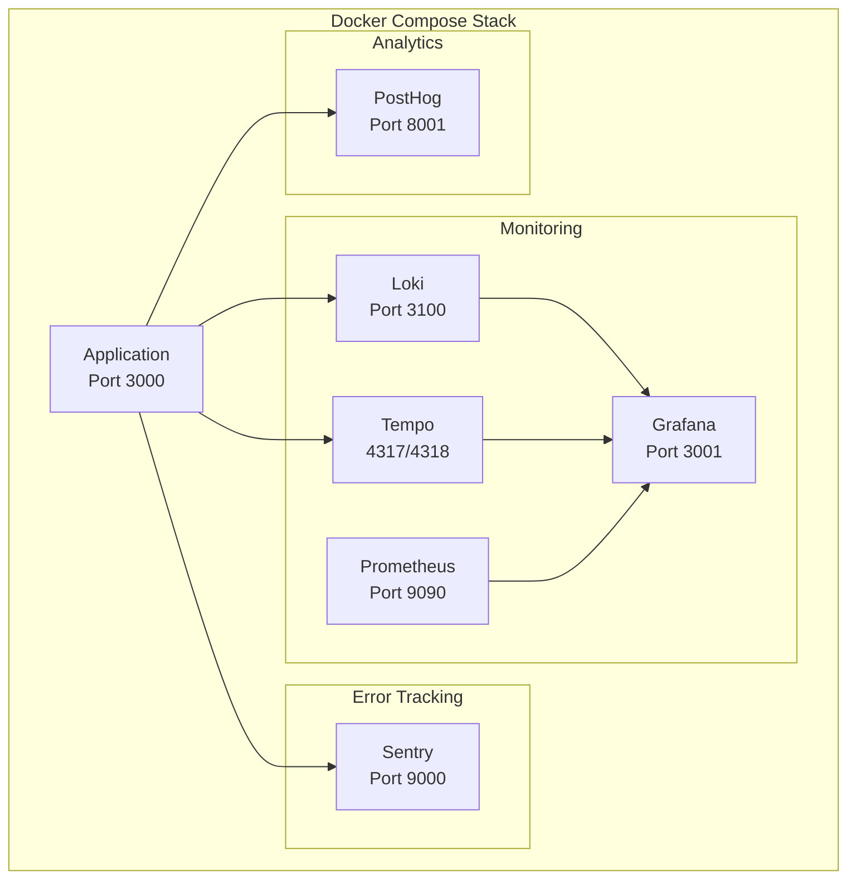

# Docker Guide

Complete guide to running the full stack with Docker Compose.

## Overview



See [DOCKER_SETUP.md](../../DOCKER_SETUP.md) for complete documentation.

## Quick Start

```bash
# Generate secret keys
openssl rand -hex 32  # Sentry
openssl rand -hex 32  # PostHog

# Configure environment
cp .env.docker .env
# Edit .env with secret keys

# Start all services
docker-compose up

# View logs
docker-compose logs -f app
```

## Services

| Service | URL | Purpose |
|---------|-----|---------|
| App | http://localhost:3000 | Your application |
| Grafana | http://localhost:3001 | Dashboards (admin/admin) |
| Sentry | http://localhost:9000 | Error tracking |
| PostHog | http://localhost:8001 | Analytics |
| Prometheus | http://localhost:9090 | Metrics |

## Common Commands

```bash
# Start services
docker-compose up -d

# Stop services
docker-compose down

# Rebuild app
docker-compose up -d --build app

# View logs
docker-compose logs -f

# Execute commands
docker-compose exec app bun run test
```

## Development Workflow

1. **Edit Code** - Changes auto-reload via hot module replacement
2. **View Logs** - `docker-compose logs -f app`
3. **Run Tests** - `docker-compose exec app bun run test`
4. **View Metrics** - Open Grafana at http://localhost:3001

## Troubleshooting

See [DOCKER_SETUP.md - Troubleshooting](../../DOCKER_SETUP.md#troubleshooting)
